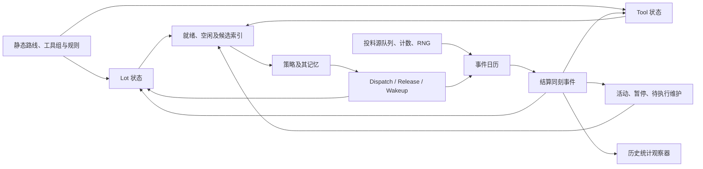

# myFab 动态状态审计与 Transformer 代理模拟器前置验证

日期：2026-10-16。范围：当前 HVLM 静态模型、`SMT2020_BASELINE` 策略、三个既有 Day 240 checkpoint。只做代码审计、特征提取计时与内存副本上的先验验证；未训练代理模型，未修改业务代码、模型数据库或 checkpoint。

## 1. 结论与研究边界

1. **Tool Group 可以作为主要聚合单位，但“每组一个 WIP 数 + 利用率”不足以描述当前系统。**同组存在不同路线位置、加工阶段、优先级、setup、LTL 绑定及剩余工作。seed 2026061700 的 `WE_FE_108` 同时包含 38 个产品/路线位置组合，对应 18 个不同的名义下一目的工具组。三个快照分别有 72、72、75 个工具组包含多个路线位置。[实测清单](D:/Project/micron/myFab/research/state_audit_20261016/measurements.json)
2. **必须把物理/控制瞬时状态、带因果作用的历史记忆、性能统计、未来已排事件分开。**累计加工片数和返工历史虽然来自过去，却会改变将来的 PM、抽检和绑定行为；历史平均 WIP、CT 则不能用当前 WIP 推出。未来事件时间也不能统一当作现场可知输入。[PM 触发](D:/Project/micron/myFab/fab/engine/engine.py:1392)、[返工与抽检](D:/Project/micron/myFab/fab/engine/engine.py:1233)、[历史指标](D:/Project/micron/myFab/fab/plugins/results.py:43)
3. **宏观提取本身成本较低，但不能按每个底层事件全量提取。**在已有快照上，G0 基础计数中位数 1.22–1.34 ms；G1 细分阶段/路线与分布摘要 7.28–7.77 ms；G2 再加已排事件摘要 13.77–14.17 ms。它们都是有损观测，不是完整 checkpoint 的替代品。[计时证据](D:/Project/micron/myFab/research/state_audit_20261016/measurements.json)
4. **已构造出相同聚合、不同微观轨迹的实例。**交换两个同组同产品同工步 Lot 的 FIFO 到达时间后，G0/G1/G2 初始输入完全相同，六小时续跑轨迹哈希不同；此例的完工总数仍相同。因此证明的是聚合不能保证微观可复现，不能据此推断宏观预测误差很大。[关联丢失实验](D:/Project/micron/myFab/research/state_audit_20261016/aggregation_collision.json)
5. **建议先定义代理目标，再定最终状态。**若目标是固定 SMT2020 策略下的小时/日尺度 KPI 或流量分布预测，可以研究有损 Tool Group 状态和历史序列；若目标是替换内核、支持任意派工/投料动作或精确复现逐 Lot 轨迹，则必须额外保留细粒度关联、策略内存和随机/事件状态。当前实测没有证明某套宏观状态已具备充分性，也没有得到代理精度或加速比。

## 2. 原生状态在哪里，如何相互依赖

### 2.1 对象、索引和控制边界

`FabModel`、路线、Tool/Tool Group 规格、分布和规则是本轮固定的静态配置。`ToolGroupSpec` 有设备数、组批/级联能力、位置、装卸时间、派工规则等；**没有独立的动态 `ToolGroupState` 类**。动态组状态散布在引擎的组索引、Tool、Lot、活动和策略实例中。[静态工具组定义](D:/Project/micron/myFab/fab/model/entities.py:27)、[引擎索引](D:/Project/micron/myFab/fab/engine/engine.py:124)



依赖方向来自 [同刻事件循环与策略调用](D:/Project/micron/myFab/fab/engine/engine.py:299)、[动作执行](D:/Project/micron/myFab/fab/engine/engine.py:360)、[活动创建](D:/Project/micron/myFab/fab/engine/engine.py:552)。策略不是无状态函数；物理状态相同而策略记忆不同，允许产生不同动作。

| 状态主体 | 主要字段/容器 | 依赖、作用和容易误读的地方 |
|---|---|---|
| Lot 身份与路线 | `id/product_id/lot_type_id/priority/wafer_count/route/operation_index/input_order` | 产品及路线位置决定资格、配方、组批、下游与剩余路线；`input_order/id` 也参与确定性派工平局裁决 |
| Lot 时间和阶段 | `generation_time/planned_release_time/release_time/ready_time/start_time/end_time/in_process/processing_tool_id` | 到池、准入、到队列、首次开工是不同时间；`start_time` 是首次开始加工的时刻，不是当前工步开始时间；`ready_time=inf` 可表示运输中，也可表示尚未准入 |
| Lot 绑定/返工记忆 | `dedicated_tools/last_tool_group_id/processed_tool_by_step/rework_tool_bindings` | 决定回哪台设备、运输从哪里出发、返工哪些步骤必须重做；不是普通日志 |
| Tool | `available_time/current_setup/current_setup_run_length/processed_wafers/is_down/is_in_setup/capacity/active_count` | 共同影响可派工性、换型、维护和级联槽位；不能只读 `in_process` |
| 活动与暂停 | `_active/_active_by_tool/_paused/_pending_batches` | 保存 `completion/finish/phase_start/next_start/batch_lots/token`；暂停额外有 `remaining/next_start_remaining/worked`。整炉和级联不能用单个 `active_lot_id` 代替 |
| 维护控制 | `_pending_pms/_pending_downtimes/_next_counter_pm` | PM 到期可能等当前加工结束；重叠停机按队列执行；每台设备、每条 wafer PM 规则有独立阈值 |
| Event Calendar | `_calendar/_sequence/_tokens/_scheduled_tool_available` | 事件按 `(time, priority, sequence)` 排序；完成事件引用活动 token；堆里可含已失效活动事件和已满足/已离厂 Lot 的 CQT 事件 |
| 就绪/空闲与候选 | `_ready_* / _free_ready_by_group / _dedicated_ready_by_group / _idle_tools_by_group / _eligible_lots_by_group / _entries_by_group / _dispatchable_candidates_cache` | 主要是物理状态的派生索引，但带有确定性顺序、脏标志和按需刷新语义，不能直接清空后继续运行 |
| Release source | `queue/_release_counts/_generated_count/rng` 与日历中每个计划的下一次 `LOT_AVAILABLE` | queue 是厂外待准入池，不属于厂内 WIP；计数用于后续身份生成；未来到达只逐次生成，并非整个 1080 日订单表都已在日历中 |
| 控制阶段和动作 | `_pending/_dispatch_needed/_changed_lot_ids/_done` | `_pending` 是已经求得但尚未执行的策略动作；`changed_lots` 是增量通知，不是完整状态，也不是历史性能指标 |
| SMT2020 策略记忆 | `_super_hot/_reservations/_blocked_since/_blocked_wakeup/_now/_wakeups` | 包含下游设备预留和 setup avoidance 计时；受过去决策影响。策略静态规则/性能缓存要另分 |
| 观察器/存储 | `_plugin_manager` 中的插件及存储资源 | 历史 WIP 积分、完工 CT、轨迹等独立于业务对象。当前 checkpoint 不保留这些观察器和存储连接 |

字段定义：[Lot/Tool](D:/Project/micron/myFab/fab/model/entities.py:241)、[策略读写接口](D:/Project/micron/myFab/fab/strategy.py:14)、[外部投料源](D:/Project/micron/myFab/fab/order_source.py:170)、[暂停与恢复](D:/Project/micron/myFab/fab/engine/engine.py:1062)、[策略记忆及预留](D:/Project/micron/myFab/strategy/smt2020_baseline.py:396)。

### 2.2 三个需要先固定的时间/位置语义

**物理位置和路线目的地是两种分组。**`_after_operation` 先推进 `operation_index`，然后开始卸载；直到 `_after_unload` 才释放 Lot。因此卸载中 Lot 的 `current_step.tool_group_id` 已是下一目的地，当前服务设备还在上一组。三个快照分别有 16、18、14 个 Lot 的服务组与路线目的组不同。聚合必须同时命名 `service_group`、`route_destination_group`；不能把两者相加当作两份 WIP。[工序完成](D:/Project/micron/myFab/fab/engine/engine.py:968)、[卸载](D:/Project/micron/myFab/fab/engine/engine.py:1021)、[实测](D:/Project/micron/myFab/research/state_audit_20261016/measurements.json)

**设备可用不等于设备没有活动。**级联设备可以有活动且仍可接收下一 Lot；装载/换型、容量、`next_start` 和停机状态都会影响可用性。`available_time` 表示派工相关的可用/槽位时刻，停机时表示维修完成时刻，不能统一解释为“最后一个 Lot 的完工时刻”。active/down/dispatch-available 三个计数不是互斥分类，不能直接相加成设备总数。[可用性判定](D:/Project/micron/myFab/fab/engine/eligibility.py:8)、[容量刷新](D:/Project/micron/myFab/fab/engine/engine.py:1453)

**已冻结批次不必全部体现为 `Lot.in_process=True`。**装载前 `_reserve_batch` 会把所有成员移出就绪队列，先冻结成员；不能把“非加工且 ready_time 已到”一律当成可派工队列。本次三个 Day 240 快照未恰好捕获这种额外冻结成员，但代码路径存在；提取器显式覆盖，未把“未观测到”解释为“不存在”。[冻结批次](D:/Project/micron/myFab/fab/engine/engine.py:751)

### 2.3 Day 240 快照的动作阶段

三个快照均在 `345651.03 minute = 240.0354375 day`，阶段为 `release_decision_pending`。外部到达已进入 release pool，SMT2020 策略的 `decide` 已执行并更新内部记忆，但其动作尚未应用；三个快照的待执行动作均是放行 `E013732/E013733`，本次 pending dispatch 为空。

原生 `apply_release_action` 会先执行该次 dispatch/wakeup，再放行，并对新入厂 Lot 再请求一次 follow-up 派工。恢复或定义训练样本时不能先重新求一次策略来替换 pending，也不能在未标注阶段时把动作前/动作后状态混用。[决策边界](D:/Project/micron/myFab/fab/engine/engine.py:329)、[执行顺序](D:/Project/micron/myFab/fab/engine/engine.py:360)、[快照保存约束](D:/Project/micron/myFab/checkpoint_tools/runtime.py:121)

## 3. 瞬时状态、历史统计和未来事件的分类

| 类型 | 例子 | 当前时点能否从其他瞬时字段重建 | 是否可能影响未来 |
|---|---|---|---|
| 瞬时物理状态 | Lot 路线位置、队列、设备 setup、活动阶段、停机、批次成员、绑定 | 部分有冗余索引；细节不能从组总数恢复 | 是，直接决定资格和转移 |
| 历史形成的因果记忆 | `processed_wafers`、每规则下一 PM 阈值、setup 连续加工量、返工已加工工步表、FIFO 到队列时间、策略 blocked 计时和预留 | 不能仅由当前总 WIP/设备状态推出 | 是；应作为当前扩展状态的一部分 |
| 已完成事件的性能统计 | 最近 1/7/30 日投入/完工、WIP 积分、CT/P95、工具组历史利用率 | 不能从单个物理快照重建 | 固定 SMT2020 策略不读取这些 KPI；可作为预测输入/训练标签；若未来策略读取则进入反馈 |
| 历史摘要但策略相关 | `_last_operation_completion[(process, visit)]` | 不能从尚存 Lot 的当前状态完整重建 | SMT2020 baseline 不读；DynamicDBR 明确读取，不能跨策略判为无关 |
| 未来已排：内生阶段结束 | 活动 `finish`、已采样运输到达、当前维修完成、级联槽位开放 | 部分与 `_active` 重复，但并非都能从 ToolState 推出 | 是；包含已采样的未来时间 |
| 未来已排：计划和控制 | `LOT_AVAILABLE/PM_DUE/STRATEGY_WAKEUP/SIMULATION_END/CQT_EXPIRE` | 需要来源/计划相位/控制记忆；全局均值不足 | 前四类影响转移或停止；当前 CQT 到期只通知统计插件 |
| 未来已排：随机外生事件 | 下一次 `BREAKDOWN` 的时刻及其 `duration` | 不是 MTTF/MTTR 均值或当前 down 标志的函数 | 是；对现场预测通常属于特权未来信息 |
| 随机状态 | 引擎 `rng`、来源 `rng` | 不由物理聚合决定 | 精确重放需要；分布代理可引入随机变量，但不可期待唯一真实轨迹 |

代码证据：[PM 阈值](D:/Project/micron/myFab/fab/engine/engine.py:1392)、[setup 计时](D:/Project/micron/myFab/strategy/smt2020_baseline.py:315)、[DBR 的完成历史依赖](D:/Project/micron/myFab/strategy/dbr_v2.py:690)、[CQT 处理](D:/Project/micron/myFab/fab/engine/engine.py:1309)、[未来故障采样](D:/Project/micron/myFab/fab/engine/engine.py:1410)。

本轮没有把“未来已安排”自动等同于“所有未来都已确定”：后续加工、抽检、返工、维修结束后的下一故障等还会继续消耗随机数并安排事件。[加工采样](D:/Project/micron/myFab/fab/engine/engine.py:646)、[卸载返工](D:/Project/micron/myFab/fab/engine/engine.py:1041)、[维修后故障](D:/Project/micron/myFab/fab/engine/engine.py:1165)

## 4. Tool Group 聚合：可保留什么，会丢什么

| 对象 | 可在组层面表达的候选特征 | 仅用总数/均值会丢失的信息 | 建议保留方式 |
|---|---|---|---|
| 队列与路线 | 就绪 Lot/wafer 数、产品×路线位置×优先级×阶段数量 | 重入工步、下游目的地、剩余路线；相同 process 不代表同一设备资格 | 工具组 token 加路线 cohort，路线图作为静态上下文 |
| 排队年龄与交期 | 等待年龄分布、分位数、优先级/交期分桶 | FIFO 身份顺序，年龄与路线/绑定的联合关系；均值相同仍可选择不同 Lot | 联合分桶、关键 Lot/top-K；交期特征须与策略目标一致 |
| 设备容量 | 设备数、down/active/可派工数、占用槽位、阶段数 | 级联剩余槽位、加载/换型阻塞、单台设备的剩余活动组合 | 至少按设备模式与阶段细分，关键设备保留个体 token |
| Setup | 当前 setup 分布、setup×占用状态分布、连续量/阻塞计时摘要 | 空闲机器与待加工 recipe 是否匹配；被预留的是哪台机器 | 保留 setup 与资格/空闲/预留的联合关系 |
| Batch | 类别内 Lot/wafer 数、距最小批量差、已冻结整炉数量 | 批兼容、最小/最大量、设备绑定限制、谁已被另一炉占用 | 按引擎实际 batch class 分桶；关键冻结成员保留关联 |
| LTL / Rework | 绑定 Lot 数、绑定目标设备数、返工段数量 | Lot—具体 Tool 边，未来 LTL 目标，返工强制执行的工步集合 | 稀疏关系或单独 token；总绑定数不充分 |
| 活动与运输 | 阶段分布、阶段已持续时间、在途目的地数 | 剩余时间与目的地/产品关联、同炉相关完工、具体输送到达顺序 | 观测版保留已持续时间；特权版另加已采样剩余时间 |
| Maintenance | 待 PM 数、每规则距下一 wafer 阈值分布、down 类型 | 同台多条规则的相关性、维修/PM 排队次序、具体剩余停机 | 按设备或联合模式表达；计划 PM 与随机故障分开 |
| Dispatch / Release | 准入数量及类型、每组投派工量、策略配置 | 选择的是哪个 Lot/Tool；该选择对绑定、换型、批次的影响 | 若支持动作干预，动作输入必须与状态粒度匹配 |
| 历史产出与利用率 | 过去固定窗口完工/投入、忙碌/故障/换型时间积分 | 不同历史路径，同均值异波动，CT 的产品/优先级混合 | 外部窗口统计；不能把当前 active 比例称为历史利用率 |

依据：[资格与绑定](D:/Project/micron/myFab/fab/engine/engine.py:1728)、[组批类别](D:/Project/micron/myFab/fab/engine/engine.py:914)、[实际批容量与候选槽](D:/Project/micron/myFab/fab/engine/engine.py:1665)、[优先级/setup/FIFO 配对](D:/Project/micron/myFab/strategy/smt2020_baseline.py:246)。上表是候选设计与丢失分析，尚未全部实现成模型特征。

### 4.1 聚合不充分的实际样本与构造反例

Day 240 seed 1700：`WE_FE_108` 有 38 个路线 cohort；`Delay_32` 有 32 个；`DE_FE_86` 有 30 个。即使只看名义下一工步，`WE_FE_108` 已有 18 个目的工具组，`Delay_32` 有 20 个。抽检跳步还可能产生更远的实际下一目的地，不能把此处的名义邻接看成完整动态转移表。[样本与下游列表](D:/Project/micron/myFab/research/state_audit_20261016/measurements.json)

进一步在 **RAM 副本** 中选择 `WE_FE_41 / Product_3 / operation_index=311 / priority=10` 的两个就绪 Lot：

| Lot | 原 ready_time（minute） | 副本 ready_time（minute） |
|---|---:|---:|
| E012177 | 345581.152560 | 345623.336628 |
| E012125 | 345623.336628 | 345581.152560 |

交换只改变“哪个 Lot 对应哪个 FIFO 年龄”，保留了组内年龄集合、cohort 数、setup/设备、事件日历和 RNG。G0/G1/G2 的全部初始输出相等，但续跑到 `346012.86 minute` 后轨迹哈希不同；两边均为 14 个投入、5990 个工序完成、15 个整 Lot 完成。

这是**身份关联损失**的构造证据，不是自然数据中的成对碰撞，也不是代理宏观误差的估计。它否定“这些聚合能够保证精确重放”，并未否定学习相同输入条件下的宏观分布。[实验脚本](D:/Project/micron/myFab/research/state_audit_20261016/aggregation_collision.py)、[两套轨迹和摘要](D:/Project/micron/myFab/research/state_audit_20261016/aggregation_collision.json)

## 5. 确定性冗余、缓存与不可随意删除的历史

这里的“可省略”是指未来的代理表示或经过正确重建的序列化方案；**不表示现在可以从引擎实例里删字段后直接继续执行**。

| 字段/信息 | 分类与结论 | 证据与限制 |
|---|---|---|
| `current_step/current_process/current_process_time/completed/step` | 确定性派生 | 来自 `route + operation_index`；`step` 是下标别名。[属性实现](D:/Project/micron/myFab/fab/model/entities.py:302) |
| 静态路线、Tool Group 规格、静态规则索引 | 可用静态模型标识/上下文共享 | 不需要每时间步重复编码整条路线；本次所有 Lot 的 `route` 均与对应产品路线共享引用 |
| `priority/wafer_count/is_super_hot` 与 `lot_type_id` | 本轮外部源有确定性重复 | Lot 类型直接给出这些属性；三快照连同投料池逐项验证一致。若未来允许动态改优先级/拆批，则不能沿用这一约简。[源对象构造](D:/Project/micron/myFab/fab/order_source.py:230) |
| ready wafer 数与 Lot 数、全厂 WIP 与阶段计数 | 本模型有计数恒等式 | 所有 Lot 均为 25 wafer，故 ready wafer=25×ready Lot；WIP=互斥阶段计数之和，不能把这些当成额外独立状态。变 lot-size 场景不成立。[恒等式验证](D:/Project/micron/myFab/research/state_audit_20261016/redundancies.json) |
| `_active_by_tool` 与 `_active` | 相同活动对象的反向索引 | 三种子逐条验证对象 `is` 相同；代理中不必双份表达，但引擎仍需要索引。[活动写入](D:/Project/micron/myFab/fab/engine/engine.py:595) |
| Tool `active_count/in_process/is_in_setup` | 多数可从活动与停机状态派生 | 三种子验证 `active_count` 一致；不能据此把活动全部压缩成一个 bool。[刷新](D:/Project/micron/myFab/fab/engine/engine.py:1453) |
| `_lots_by_id`、就绪/空闲/候选缓存 | 索引/派生视图，不是新的独立物理自由度 | 需要保留顺序和正确失效/重建。不能调用 `_state()` 当作纯读取器：它会清空 changed 集合、清理完成 Lot，且可能刷新候选。[快照方法](D:/Project/micron/myFab/fab/engine/engine.py:1525) |
| `_matching_tools_cache`、策略 `_expected_setup_cache/_min_run_cache` | 静态查询的性能缓存 | 清空 matching/min-run 后，六小时完整轨迹及 44 组状态摘要一致；恢复器本就清理旧进程 `id(step)` setup 缓存。[加载器](D:/Project/micron/myFab/checkpoint_tools/runtime.py:170) |
| 已离厂 Lot 的 `_lot_order` 项 | 本轮发现的保留历史，可在保持存活 Lot 顺序和 admitted counter 时裁剪 | 1700/01/02 分别有 11629/11486/11601 个此类键；裁剪 seed1700 副本后六小时轨迹一致，摘要仅此字典不同。未改真实对象/文件 |
| Lot `operation_history` | 当前路径未使用的占位列表 | 三快照长度均为 0，业务代码搜索仅见字段定义；不应误认为完整事件日志已经保存在 Lot 中。[字段](D:/Project/micron/myFab/fab/model/entities.py:300) |
| Tool `current_recipe_id`、名称/type 等 | 占位/静态描述为主 | 当前源码没有给 `current_recipe_id` 更新；name/type 可由固定设备规格得到。`current_product_id` 可保留上次派工值，不能视为当前活动产品的充分表示。[派工写入](D:/Project/micron/myFab/fab/engine/engine.py:546) |
| 累计 `processed_wafers` 和 PM 阈值 | 不能只删一个；存在替代编码的可能 | 每条规则的 `threshold - processed_wafers` 表达距下一 PM 的距离，但必须按设备×规则保留；组均值不能保持触发时刻。本轮只测摘要，未实现等价内核替换 |
| `processed_tool_by_step` | 有因果作用的历史，不能当冗余日志删除 | 三快照分别有 441978/490604/463388 项；返工读取已加工工步和设备，恢复 LTL，决定哪些抽检工步强制重做。[返工读取](D:/Project/micron/myFab/fab/engine/engine.py:1244) |
| `rework_tool_bindings` 中的 `None` | 有意义的存在性标记 | `None` 表示该工步仍须重做但组内自由选机；缺键则可能再次抽检。`get(key) is None` 不足以区分两者。[强制重做](D:/Project/micron/myFab/fab/engine/engine.py:1266) |
| `dedicated_tools/last_tool_group_id` | 影响未来 | 当前绑定和跳步前最后实际设备组不能仅由当前下标唯一推出，涉及资格和运输。[绑定资格](D:/Project/micron/myFab/fab/engine/engine.py:948)、[运输](D:/Project/micron/myFab/fab/engine/engine.py:1873) |
| `_last_operation_completion` | 策略依赖的历史摘要 | 清空后当前 baseline 六小时轨迹不变，但 DBR 读取它，不能作为全系统永久冗余删除。[DBR](D:/Project/micron/myFab/strategy/dbr_v2.py:963) |
| `_reservations/_blocked_since/_blocked_wakeup` | 影响策略未来的记忆 | 同一工厂物理快照未必唯一决定已有预留或已等多久；未做可删性证明。[保留预留](D:/Project/micron/myFab/strategy/smt2020_baseline.py:414) |
| Lot ID、事件 sequence、token | 部分属于标识/控制编码，但不是任意可删字段 | Lot ID/到达顺序参与平局；sequence 决定同刻次序；token 关联活动与旧事件。可研究保持全部关联的规范化，但本轮未实施 |

### 5.1 内存副本续跑验证

使用 seed 2026061700，从同一 Day 240 checkpoint 派生独立副本，原生 `SMT2020_BASELINE` 继续运行到第一个不早于六小时后的安全 release 边界。实际区间为 `345651.03 → 346012.86 minute`（约 6.0305 小时）。引用轨迹逐项覆盖投料、工序完成、整 Lot 完成；末态用既有 44 组 fingerprint 比较。比较窗口短，结果只作为先验验证。

| 内存中唯一干预 | 初始 G0/G1/G2 | 六小时轨迹 | 末态差异/解释 |
|---|---|---|---|
| 清空静态 matching/min-run 缓存 | 全相同 | 完全相同 | 44 组摘要全部相同 |
| 裁掉已离厂 Lot 的 order 映射键 | 全相同 | 完全相同 | 只有 `_lot_order` 不同 |
| 清空最近工序完成时间表 | 全相同 | 完全相同 | 只有 `_last_operation_completion` 不同；限当前 baseline |
| 引擎 RNG 多取一次随机数 | 全相同，包括 G2 | 不同 | 5990→5995 次工序完成，15→16 个整 Lot 完成；说明尚未采样的未来也重要 |
| 一个未来故障延后一天 | G0/G1 相同，G2 不同 | 不同 | 5990→5955 次工序完成；当前物理状态不包含该未来差别 |

故障干预对象为 `LithoTrack_FE_115#030`：原定 `345676.709506 minute` 故障，停机持续时间 `542.21556089 minute`；副本将故障时刻延后 1440 minute，其他初始状态保持。它是人工构造的外生事件干预，不是对现场真实故障影响的估计。RNG 干预也不能证明分布代理必须输入 PRNG 内部位状态，只证明精确轨迹依赖隐藏随机状态。

证据：[实验结果与完整哈希](D:/Project/micron/myFab/research/state_audit_20261016/counterfactuals.json)、[续跑与实验实现](D:/Project/micron/myFab/research/state_audit_20261016/audit_state.py:373)。

## 6. 未来日历审计与输入可见性

Day 240 日历规模分别为 3571、3575、3525 条。seed1700 的主要项目为：故障 1001、PM 到期 905、加工完成 915、CQT 到期 282、槽位开放 166、PM 完成 115、运输完成 109、维修完成 33，另有装载/卸载/setup 完成、5 个投料计划的下一到达及 1 个仿真结束事件。[逐类计数](D:/Project/micron/myFab/research/state_audit_20261016/measurements.json)

不能直接把“堆长度”当作未来有效工作量：三个快照分别有 4/3/2 条旧活动完成事件，3/4/0 条 Lot 已不存在的 CQT 事件；另有 172/151/162 条 CQT 已被当前进度满足。旧活动按 `_active[(tool_id, token)]` 是否存在判断，不是简单拿 token 与该 Tool 的最大 token 比较，后者会误判并发级联活动。[token 检查](D:/Project/micron/myFab/fab/engine/engine.py:1439)、[CQT 条件](D:/Project/micron/myFab/fab/engine/engine.py:1309)

这里的 CQT “未满足”是**当前时刻**的条件分类，不代表到事件到期时一定违反；本次恢复器不加载 CQT 统计插件，CQT 本身也不直接改变路线或 SMT2020 派工规则。日历中的 `TOOL_AVAILABLE` 仍按原逻辑刷新容量，不能按旧活动事件的规则统一判为可忽略。

输入契约应分两条研究路线：

- **观测/运营预测版**：已发生阶段、队列、可观测计数、政策、公开订单/维护计划。未发生的随机故障准确时刻及已采样修复时长不作为常规输入；未观测到的真实加工剩余时间也需估计。G1 是这一方向的候选，读取了引擎内部阶段/计数，仍需将来明确现场可测性。
- **内部内核代理版**：允许读取已采样阶段结束、运输、维修和随机故障日历。G2 可作为特权输入对照；任务是在给定这些已排事件条件下近似内核。此时使用日历不是训练时偷看标签，但部署也必须提供同等信息。

G2 只是时间桶+最近时刻的有损摘要，未保留完整事件顺序、Lot/Tool 边或 RNG；即使选内部代理任务，也不能把 G2 称为充分状态。固定窗口序列有助于提供记忆，不能恢复未暴露的随机未来，亦不能从本轮结果推断 Transformer 能自动补齐所有关联。

## 7. Day 240 候选宏观状态与提取成本

### 7.1 已实现的三个只读提取器

| 编号 | 本轮实际提取内容 | 不包含/有损部分 |
|---|---|---|
| G0 | 106 组×10 项：设备/down/active/可派工数、capacity/active slots、ready Lot/wafer、按当前路线目的地的 Lot 数、池中目的地 Lot 数；另有时钟、WIP、池大小、pending 标志与动作数量 | 不读取未来日历，不保存路线分布、队列顺序或具体动作身份 |
| G1 | G0 + 13 类 Lot 阶段计数；`service_group×phase×product×route_index×priority×required_setup` 稀疏 cohort；Lot 厂内年龄/就绪等待的 count/sum/min/max 与等待直方图；setup×down×active_count×run_length 分布；绑定数量、wafer PM 阈值距离、阶段已持续时间、策略阻塞时间和预留数量 | 没有个体边；没有完整批类别/交期/CQT slack；年龄与 cohort 的关联丢失；setup 连续量在该原型中裁到 32，不能视为无损；维护距离只有组摘要 |
| G2 | G1 + 按组/事件类型/当前有效性/剩余时间桶的日历计数、各类最近事件、活动与暂停剩余时间摘要 | 含特权未来；没有完整堆、载荷关联和顺序 |
| H30（独立） | 从既有 run.json 读取截止第 240 日的完整日数据，生成过去 1/7/30 日工厂级平均 WIP、投入/产出、CT 均值/P95 | 不属于 checkpoint 自带瞬时状态；没有既有工具组级历史利用率；未使用第 240.035 日之后的数据 |

时间桶上边界为 `[1,5,30,120,480,1440] minute` 加溢出桶，边界包含在较小桶中。数值摘要保存 count/sum/min/max，均值可由 count/sum 确定性得到。静态组 ID、产品路线映射只准备一次。[提取实现](D:/Project/micron/myFab/research/state_audit_20261016/audit_state.py:84)

G1 阶段归属验证：

| seed | WIP | ready | 正常加工阶段 Lot | 装载/换型/卸载 Lot | 暂停 Lot | 在途 Lot | 未分类 |
|---|---:|---:|---:|---:|---:|---:|---:|
| 2026061700 | 2102 | 837 | 1088 | 39 | 29 | 109 | 0 |
| 2026061701 | 2245 | 973 | 1104 | 38 | 34 | 96 | 0 |
| 2026061702 | 2130 | 888 | 1078 | 37 | 28 | 99 | 0 |

每个 Lot 仅计入一个阶段，三行分别精确加回 WIP。加工阶段 Lot 数可大于加工活动数，因为一炉活动包含多个 Lot。所有提取前后 checkpoint 业务 fingerprint 均不变。

### 7.2 计时方法与结果

环境：Windows、Intel Core i7-12700H、CPython 3.12.14，与 checkpoint 版本一致。三个 seed 在**单进程中顺序测试**；计时用 `perf_counter_ns`，GC 保持启用；每种提取预热 8 次、正式 180 次，P95 为 nearest-rank。CPU 型号从本机注册表读取。

计时不包括 Python 进程启动、checkpoint 加载/校验、静态上下文准备、JSON 写盘、Transformer 推理或 GPU 传输；提取过程本身新分配结果容器。使用原有只读索引加扫描，不调用会改状态的 `_state()`/策略方法。它是当前 Python 原型的成本，不是优化后的理论下限。反复读取同一快照偏热缓存，仅覆盖本轮三个稳态规模，不是跨时间/所有负载的性能置信区间。

| seed | G0 median / P95 ms | G1 median / P95 ms | G2 median / P95 ms | G1 cohort 数 |
|---|---:|---:|---:|---:|
| 2026061700 | 1.226 / 1.468 | 7.280 / 8.396 | 13.864 / 18.417 | 811 |
| 2026061701 | 1.336 / 1.508 | 7.765 / 8.826 | 14.169 / 20.436 | 836 |
| 2026061702 | 1.217 / 1.460 | 7.461 / 8.764 | 13.773 / 19.471 | 817 |

独立成本：

| 项目 | 三个 seed 范围 | 说明 |
|---|---:|---|
| Checkpoint 加载及完整校验 | 1282–1371 ms | 每 seed 一次；不是每次提取成本，也不能将与上轮的时间差当作内核优化 |
| 静态映射准备 | 0.572–0.693 ms | 每模型一次，覆盖 106 组及 926 路线工步 |
| G0 JSON 编码 median | 0.062–0.072 ms | 4496–4527 bytes；仅编码、不写盘 |
| G1 JSON 编码 median | 1.416–1.652 ms | 90204–91237 bytes |
| G2 JSON 编码 median | 2.250–2.343 ms | 164202–167173 bytes |
| H30 过去窗口摘要 median | 0.994–1.053 ms | 原始 run.json 已读取，包含 CT 样本排序；仅工厂级 |

原始计时包含每组 min/max/P95、独立 JSON 编码时间和历史源读取时间，见 [measurements.json](D:/Project/micron/myFab/research/state_audit_20261016/measurements.json)。

例如 seed1700 的瞬时 WIP 为 2102 Lot，而过去完整 30 日平均 WIP 为 2075.549 Lot、完工 1725 Lot。这些是不同时间口径，不是同一字段的两种编码。checkpoint 不包含此前观察器的窗口积分和已离厂 Lot 的完整完成记录；H30 必须另外读取既有历史产物，不能仅从当前快照推出，也不能据此恢复过去工具组级利用率。[历史观察器](D:/Project/micron/myFab/checkpoint_tools/runtime.py:234)

WIP、throughput 和 CT 的相关性也不构成字段冗余：长期平均量的关系不能作为瞬时恒等式，不能据当前 WIP 唯一还原过去或未来 CT。

### 7.3 连续数值缓冲区的打包验证

进一步把 G1 的数值部分打包为 `106×54 float32` 连续缓冲区（22896 bytes），把路线 cohort 打包为 `811–836×7 int32`（22708–23408 bytes）。纯 CPU 打包中位数 0.934–0.980 ms；同次测量中，**提取 G1 + 打包**中位数 7.702–8.126 ms，P95 8.269–9.329 ms。

此打包只覆盖核心组数值及 cohort token，未打包 `setup_joint` 旁路表，也未做嵌入、归一化、padding、时序堆叠、GPU 拷贝或网络前向。类别码是本次局部稳定编号的演示，正式数据集需要模型级统一词表；不能直接把任意类别整数当作具有连续物理意义的浮点特征。[打包实现](D:/Project/micron/myFab/research/state_audit_20261016/pack_features.py)、[结果](D:/Project/micron/myFab/research/state_audit_20261016/packing.json)

### 7.4 提取频率决定实际开销

本原型 G1 约 7.5 ms/次，若每仿真小时提取一次，约为 **0.18 CPU 秒/仿真日**；若每分钟提取，约为 **10.8 秒/仿真日**。这是按调用次数线性相乘的预算估计，不是包含仿真的联测加速结果。

此前稳态事件研究合计 90 个 seed-days，有 3607322 次真实策略调用，约 40081 次/仿真日；若逐次全量提取 G1，预算约 **301 秒/仿真日**，足以超过原仿真耗时。因此应先明确宏观时间步/事件采样频率，或将来研究增量提取；不能因为“单次只有几毫秒”就挂到每次 dispatch。[先前事件统计](D:/Project/micron/myFab/report_smt2020_warmup.md:237)

## 8. 对下一阶段研究的可执行建议

1. **先固定任务协议。**分别定义固定 SMT2020 策略下的 KPI/组间流量代理，和接受外部 release/dispatch 动作的转移代理。后一种需要明确动作粒度、政策上下文及数据覆盖；当前三个同策略稳态快照无法验证其他政策。
2. **建立分层输入对照。**以 G0 为计数基线，G1 为路线/阶段增强基线，G2 为未来日历特权对照；H30 明确单独输入。它们不应混成一个“当前状态”字段后宣称支持现场预测。
3. **保留难聚合关系。**优先研究 LTL/返工绑定、关键批次、setup—队列匹配、活动剩余时间与下游目的地的联合表达。当前约 800 个 cohort 已说明“106 个组 token”以外还存在显著结构。
4. **把观测和标签分开。**瞬时 ready/active 比例与历史平均利用率、过去完工 CT 与未来完工 CT、队列年龄与厂内年龄分开命名；严格限定历史窗口截止时点。原 `OnlineMetricsPlugin` 的 CT 用 generation_time，而 checkpoint 观察器用 release_time，若以后控制 release pool 等待，两者不再相同。[原指标](D:/Project/micron/myFab/fab/plugins/results.py:87)、[checkpoint 指标](D:/Project/micron/myFab/checkpoint_tools/runtime.py:260)
5. **后续验证应以目标为准。**不同 checkpoint/seed、非稳态负载与动作干预应独立验证；检查多步滚动下的 Lot/wafer 守恒、组间流量、停机约束、批阈值及 WIP/throughput/CT 分布。聚合轨迹相同和逐 Lot 轨迹相同是不同标准；本轮没有开始训练或宣称通过这些预测验证。

本轮依据表明：**可以启动以 Tool Group 为主体的代理状态实验，但尚不能把纯 Tool Group 总量认定为闭合状态。状态粒度、隐藏关联和未来可见性，比先选 Transformer 网络大小更应先确定。**

## 9. 产物、复现与文件完整性

研究代码及证据均在新目录 [research/state_audit_20261016](D:/Project/micron/myFab/research/state_audit_20261016)。主要文件：

- [audit_state.py](D:/Project/micron/myFab/research/state_audit_20261016/audit_state.py)：只读提取、状态清单、计时、内存副本干预及完整性检查。
- [source_inventory.json](D:/Project/micron/myFab/research/state_audit_20261016/source_inventory.json)：关键文件的函数与 self 属性位置索引。
- [measurements.json](D:/Project/micron/myFab/research/state_audit_20261016/measurements.json)：三个 seed 的全量计时与审计计数。
- `seed_<seed>_G0/G1/G2.json`：各快照的真实候选特征输出。
- [counterfactuals.json](D:/Project/micron/myFab/research/state_audit_20261016/counterfactuals.json)、[aggregation_collision.json](D:/Project/micron/myFab/research/state_audit_20261016/aggregation_collision.json)：短续跑和聚合碰撞验证。
- [packing.json](D:/Project/micron/myFab/research/state_audit_20261016/packing.json)：核心特征打包计时。
- [redundancies.json](D:/Project/micron/myFab/research/state_audit_20261016/redundancies.json)：逐 Lot 类型属性、路线共享及计数恒等式验证。
- [integrity.json](D:/Project/micron/myFab/research/state_audit_20261016/integrity.json)：83 个受保护既有文件的 SHA-256 对照，包含业务/测试/checkpoint 工具 Python 源、模型数据库、既有 checkpoint 实验产物及旧报告，变化为 0。Git tracked diff 为空。

复现需复制这四个新研究脚本到项目 `research/` 下**另一个新的输出目录**再运行，并使用该新目录路径，或保留旧结果并调整脚本输出目录。结果默认 `open('x')`，不会覆盖已有证据。使用 checkpoint 原 CPython 3.12.14，并加 `-B` 避免更新已有字节码；以下为本次已执行的命令路径，原路径再次运行会拒绝覆盖结果：

```powershell
$python = 'C:\Users\ZZY\.cache\codex-runtimes\codex-primary-runtime\dependencies\python\python.exe'
& $python -B 'research/state_audit_20261016/audit_state.py'
& $python -B 'research/state_audit_20261016/aggregation_collision.py'
& $python -B 'research/state_audit_20261016/pack_features.py'
& $python -B 'research/state_audit_20261016/check_redundancies.py'
```

所有字段清理、RNG/故障/FIFO 干预仅发生在本机可信 checkpoint 加载出的 RAM 副本，未保存成新 checkpoint，也未写回原文件。原 checkpoint 加载仍执行来源、模型、payload、运行时兼容性及语义摘要校验。
